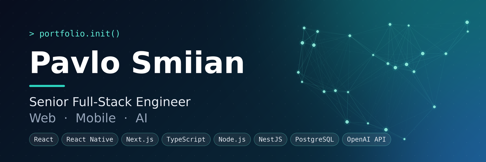

  

<h1 align="center">Pavlo Smiian</h1>

<b>Senior Full-Stack Engineer</b> · React / Node.js / React Native · Kyiv, Ukraine

<i>Web, mobile and AI - shipped as one connected system, not handed off between teams.</i>

  
  

---

## ▸ Snapshot

| | |
|---|---|
| **Experience** | 6+ years building production systems |
| **Building now** | EaseMate AI and PanelsAI - two AI products, both live with real users |
| **Open to** | Senior Full-Stack or Full-Stack + Mobile roles with remote-first EU/US teams |
| **Prefer** | Async-first cultures building AI-integrated or high-load platforms |
| **Ask me about** | React Native in production · NestJS at scale · LLM integration · Kafka event streaming |

---

## ▸ Toolbox

| Layer | Technologies |
|---|---|
| **Frontend** |      |
| **Mobile** |   Push notifications · Deep linking · In-app purchases · App Store / Google Play deployment |
| **Backend** |     WebSocket · Socket.io · JWT |
| **Data and messaging** |     RabbitMQ · Supabase · Firebase |
| **AI** | OpenAI API · Computer vision integration · LLM-powered automation |
| **Infra and testing** |   CI/CD · Jest · Vitest · Cypress · React Testing Library |

---

## ▸ Selected work

<table>
  <tr>
    <td width="50%" valign="top">
      <h3><a href="http://www.aurafit.com/">AuraFit Coach</a></h3>
      
AI-powered fitness app with real-time exercise form correction via computer vision, meal analysis and subscriptions.

      <b>Role:</b> Senior Full-Stack, led the React Native + TypeScript app end to end 
      <b>Built:</b> AI camera form tracking · AI coaching assistant · RevenueCat / StoreKit purchases · subscription lifecycle 
      <b>Skills:</b> React Native · TypeScript · Node.js · Next.js · OpenAI API · Stripe SDK · Tailwind CSS · Computer Vision Integration · Mobile Application Development · In-App Purchases
    </td>
    <td width="50%" valign="top">
      <h3><a href="https://www.easemate.ai/">EaseMate AI</a></h3>
      
Multimodal orchestration platform unifying AI chat, document analysis and media generation, with a public SDK.

      <b>Built:</b> chat module · document analysis pipeline · media generation APIs · JWT auth 
      <b>Skills:</b> React.js · Node.js · Express.js · Socket.io · JSON Web Token (JWT) · Supabase · GitHub · Jest
    </td>
  </tr>
  <tr>
    <td colspan="2">
      <h3><a href="https://panels.ai/">PanelsAI</a></h3>
      
SaaS workspace unifying GPT, Claude and other models for website development and marketing automation.

      <b>Built:</b> drag-and-drop story builder · reusable landing components · API integration 
      <b>Skills:</b> React.js · Next.js · Node.js · NestJS · TypeScript · Redux.js · Tailwind CSS · Docker
    </td>
  </tr>
</table>

---

## ▸ How I work

- **One connected system.** Frontend, backend and mobile are designed together, so nothing gets lost in a handoff.
- **Real-time is infrastructure.** It is a property of the whole stack underneath, not a UI feature.
- **Share what I know.** I mentor on TypeScript architecture and keep code reviews fast.

---

Open to work · remote EU/US

